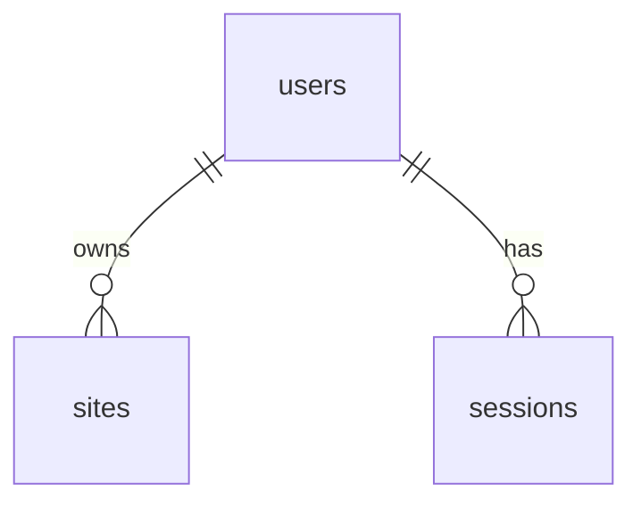

# Architecture and implementation decisions

## Architecture and tools

Both apps live in one repository because they evolve together, share a generated API contract and ship as one application.

The Python backend serves the API and, in Docker, the built React app. This keeps the required launch to one container. FastAPI and Pydantic provide validation and OpenAPI together. SQLite needs no separate service, and Alembic applies schema changes at startup.

Async FastAPI handlers use `httpx.AsyncClient` for PVGIS and SQLAlchemy/aiosqlite for database access. While a request waits for I/O, the event loop can serve other requests. Password hashing runs in worker threads to avoid blocking the event loop.

Backend features live in `modules/auth`, `modules/sites` and `modules/energy`. Routes handle HTTP and inject dependencies into services, which enforce ownership and application rules and own transactions. Startup wires shared resources and manages their lifecycle. `infra/` handles database and PVGIS access; `platform/` supplies HTTP mechanisms and dependency providers; `shared/` holds transport-independent errors. Infrastructure and platform do not import features. Separating HTTP, application rules and integrations keeps domain logic independently testable and limits the impact of external-service changes.

The frontend separates application routing and shell (`app/`), pages and feature queries (`features/`), typed API access (`infra/`) and reusable UI (`shared/`). Authentication owns the session lifecycle and query cache.

React Router handles navigation, TanStack Query manages API state, React Hook Form/Zod handles forms, and Tailwind styles the UI. Vite+ combines the development server, builds and frontend checks. mise pins tools; uv and pnpm lock dependencies for repeatable setup.

FastAPI routes and Pydantic schemas define the API. `mise run api:generate` generates [OpenAPI](../apps/backend/openapi.json) and [frontend types](../apps/frontend/src/infra/api/schema.d.ts); verification catches drift. SQLAlchemy models and Alembic migrations own the database schema.

## Data relationships



Normalized, unique emails prevent duplicate accounts.

## External service and configuration

Only the backend calls PVGIS v5_3; no key is required. It sends coordinates, peak kWp, system loss and configured solar parameters.

The [energy model](energy-model.md) explains production data, domain defaults, consumption assumptions and battery calculations.

Requests have timeouts, bounded concurrency and at most two retries for temporary failures. No-data, invalid-response and temporary-failure errors are kept distinct. There is no backend response cache; TanStack Query caches frontend API state in memory.

[config.py](../apps/backend/src/solar_sites/config.py) defines settings, defaults and bounds. Environment variables use uppercase names such as `DATABASE_PATH` and `PVGIS_YEAR`. [.env.example](../.env.example) supplies local development settings. The backend development task reads `.env`; Docker accepts environment variables directly.

## Sessions, authorization and errors

Passwords use Argon2. Random server-side sessions are stored in SQLite with a hashed session token and a fixed eight-hour default expiry. The browser receives an HttpOnly, SameSite=Lax cookie, marked Secure for HTTPS. Logout deletes the active session.

Writes check the allowed Origin. Authenticated writes also require the session's CSRF token in `X-CSRF-Token`; the frontend holds that token in memory. Logout or a response rejecting an expired session clears private frontend query state.

Site access is always scoped to the signed-in advisor, including before production and battery requests. Missing sites and another advisor's sites both return 404 to avoid disclosing ownership. Errors share a consistent envelope with a safe message, request ID and per-field validation issues where applicable. Logs omit credentials and site values.

| Status | Reason |
| --- | --- |
| 201 / 200 / 204 | Created account or site; successful read/login/update; logout/delete with no body. |
| 401 / 403 | Missing/expired session or wrong credentials; rejected Origin/CSRF. |
| 404 | Site absent or unavailable to this advisor. |
| 409 | Email already registered. |
| 422 | Invalid fields or a location with no PVGIS data. |
| 502 / 503 | Invalid upstream response; temporary upstream failure or saturation. |

## Storage and runtime

Docker copies a non-editable Python environment and the built frontend into the runtime image; build tools stay in the build stages. It runs as a non-root user and stores SQLite data under `/data`. Startup applies migrations before accepting requests. Use one application process per SQLite database.

To reuse data across containers and bind only to localhost, use a named volume instead of the README's basic run command:

```sh
docker run -p 127.0.0.1:8000:8000 --mount type=volume,src=solar-sites-data,dst=/data solar
```

Reattach the same volume to retain accounts, sessions and sites; deleting it removes those records. The basic command creates an anonymous volume, which a new container does not automatically reuse.

The supplied setup is intended for local assessment. The required `-p 8000:8000` mapping publishes on all host interfaces; the alternative above limits it to localhost.

## Verification

- **Frontend unit tests:** Site form validation, mapping API errors onto known form fields, site cache updates, invalidation, deletion, in-flight response cancellation and full session-cache disposal, using Vite+'s test runner.
- **Browser tests:** Playwright covers registration, site validation and CRUD, reload persistence, production and battery comparison, login errors, login/logout and protected-page access. Chromium exercises the built frontend and real backend with a temporary SQLite database; only PVGIS is replaced with fixed responses.
- **Backend tests:** Pure energy calculations and integration tests with temporary SQLite and mocked PVGIS, covering sessions, ownership, validation, persistence and upstream failures.
- **`mise run container-smoke`:** Builds the image and checks startup, static assets, authenticated site creation and persistence across container recreation, then cleans up.

[CI](../.github/workflows/verify.yml) installs Chromium and runs the README's verification and container checks.
